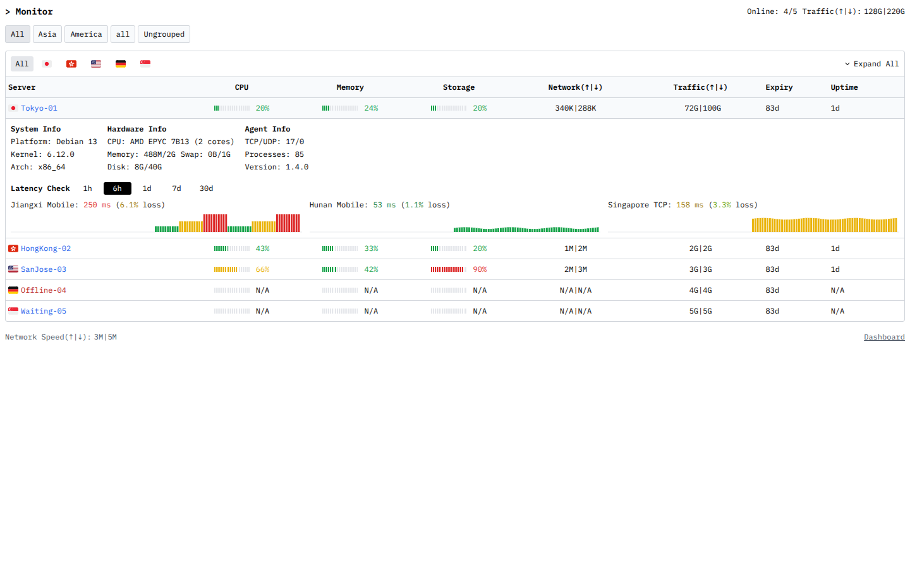

# Monitor ASCII

将 [facl/komari-ascii](https://github.com/facl/komari-ascii) 的终端界面迁移到 [Monitor](https://monitor-document.pages.dev/dev/theme)。正式版 1.0 按修改意见采用白底黑字、在线节点蓝字、离线节点红字；保留等宽字体、紧凑表格、顶部统计、展开详情和总网速。表格按内容所需宽度和剩余空间分配列宽，随容器变窄逐级隐藏次要列和进度条，手机节点与指标保持单行。



## 安装

1. 下载本项目的 **monitor-ascii-1.0.tar.gz**（构建时为 `theme.tar.gz`）。
2. 在 Monitor 后台的「主题」页上传该包。
3. 选择 **Monitor ASCII**，刷新公开状态页。
4. 在主题卡片的设置按钮中调整公告、分组、顶部统计及延迟检查显示。时间范围直接在节点详情中切换。

**不要上传源码 ZIP，也不要上传原 Komari 的 ZIP。**

也可手动安装到一键脚本部署的目录：

```bash
mkdir -p /opt/monitor/data/themes/monitor-ascii
tar -xzf theme.tar.gz -C /opt/monitor/data/themes/monitor-ascii
```

安装包根目录直接包含 `theme.json`、`preview.png`、`dist/`。Hub 安装器读根目录的 `theme.json`，再根据 `short` 创建 `monitor-ascii/` 目录。文档的安装目录示意与压缩包根目录是两层不同的概念；打包方式已按官方默认主题发布脚本和 Monitor 1.4.0 安装器核对。

## 功能

- 白底黑字、终端等宽排版。在线节点名为蓝色，离线节点名为红色；在线但未上报指标的节点仍为蓝色。
- 左上角为 `> Monitor`，右侧为 `Online: 4/5` 和 `Traffic(↑|↓): 128G|220G`。在线数与 Traffic 保持同一行，统计跟随当前分组及地区筛选；在线写法固定，没有额外配置项。
- 表格顶部 Expand All 左侧为 `All` 和国旗筛选按钮，根据系统节点的 `country` 字段自动生成，国旗按节点首次出现顺序排列并去重。按钮无边框；表格容器至少 640px 时最小宽度为 36px，否则为 30px，左右内边距各为 5px，按钮间距为 3px。选中按钮显示灰色背景，保留悬停和键盘焦点。只有 All 显示文字，其余按钮只显示主题内置 SVG 国旗，悬停提示和无障碍标签提供地区名称。地区筛选与原有分组组合使用；切换分组会重置地区为 All，在线数、流量、底部网速跟随当前筛选。无有效地区的节点保留在 All 中；所选地区从快照消失时回到 All。按钮较多时自动换行，Expand All 保持右侧，使用现有“显示分组”开关。
- 宽屏表格为 Server、CPU、Memory、Storage、Network、Traffic、Expiry、Uptime 八列；CPU、Memory、Storage 的表头在各自单元格中居中。容器宽度至少 600px 时，三项资源使用原主题的 20 段进度条与整数百分比；原始使用率低于 50% 为绿、50%～80% 为黄、高于 80% 为红，空闲段为灰色。百分比数字与进度条使用相同分段和颜色，隐藏进度条后仍有颜色；N/A 保持黑色。
- Expiry 在 Uptime 前面。剩余时间低于 3 天及已过期显示红色，3 天至低于 7 天显示黄色，7 天及以上保持黑色；N/A 和 Long term 保持黑色。按 hub 提供的剩余天数判断，仅对到期文字上色。Uptime 使用整数和缩写，如 `5d`、`16h`、`30m`，不含空格；低于一分钟显示 `0m`，离线或尚未上报为 `N/A`。
- Network、Traffic、Network Speed 恢复 1.3.5 的整数紧凑单位 B/K/M/G/T 等，按 1024 换算，不显示箭头、空格或 `/s`。方向只在标签中写为 `Network(↑|↓)`、`Traffic(↑|↓)`、`Network Speed(↑|↓)`；数值统一为上传在前、下载在后，以 `|` 分隔，如 `340K|288K`、`72G|100G`、`3M|5M`。表格分隔符位于列中心并逐行对齐。
- 表格 Traffic 显示 hub 提供的本计费周期上传、下载流量；顶部 Traffic 显示累计上传、下载流量。旧的已用/配额写法已替换。离线节点仍显示周期流量，实时网速显示 `N/A|N/A`。
- 表格填满可用宽度，没有固定最小宽度或滚动条预留空间。资源列为进度条、完整百分比及间隔保留最小宽度；流量列为完整表头、上传/下载值保留最小宽度，剩余空间按列的权重分配。有进度条的布局中，Server 的宽度取容器的 21.5622%，并限制在 114.9984～287.496px，相对 1.3.13 缩窄 10%。腾出的空间按资源列 1、流量列 1.15、Expiry 0.6、Uptime 0.7 的权重分配，同时保留各列的内容最小宽度；隐藏进度条后的手机布局继续使用 2.43/0.8/1/1.1/1.4 的权重，保持上一版的 Server 宽度。
- 响应式逻辑基于表格容器的实际可用宽度：不足 780px 隐藏 Uptime，不足 700px 再隐藏 Expiry，不足 640px 再隐藏 Traffic，不足 600px 隐藏 CPU、Memory、Storage 的进度条。1055px 视口完整保留八列，574px 视口的资源列保持合理间距；同一套规则适用于其他宽度和较窄的父容器，没有针对这两种视口的特殊样式。
- 手机仍保留 Server、CPU、Memory、Storage、Network 五列，节点名与四项数值同一行。空间不够时节点名显示省略号，不换行，完整名称保留在悬停提示和无障碍标签中。展开详情不重复显示节点名。日期和长硬件文本可换行，不足 320px 时适当缩小表格字号。
- 移除 Tags、Load、Status、搜索、排序、统计卡片、管理员/公开标识以及 Original theme 链接；节点和分组保持后台顺序。每行开头的展开箭头已移除，仍支持点击节点名或整行展开，以及顶部 Expand All / Collapse All。
- 展开详情仅为 System Info、Hardware Info、Agent Info。System 显示系统、内核和架构；Hardware 显示 CPU、Memory、Swap、Disk 的已用/总量，总容量大于 0 时显示 Swap，即使已用量为 0；实时总容量为 0 时隐藏 Swap，离线或等待上报时使用硬件总容量判断。有 Swap 时 Memory 与 Swap 保持同一行，如 `Memory: 489M/967M Swap: 0B/1G`；Agent 集中显示 TCP/UDP、Processes、Version。容量采用整数紧凑单位，`/` 两侧没有空格；实时总量优先，离线已用量为 N/A。
- 每个节点自动显示前三项延迟检查，不显示检查后的时间，也没有加载/隐藏按钮、Traffic 或 Load 详情。江西移动、湖南移动对应 `Jiangxi Mobile`、`Hunan Mobile`，其他检查保留后台名称。
- Latency Check 后有 `1h`、`6h`、`1d`、`7d`、`30d` 五个按钮，各节点独立选择，默认 6h。按钮无边框，桌面最小宽度 44px、手机 36px，保留黑底白字选中状态和键盘焦点。切换后重新请求该时段的历史；较晚返回的旧请求不会覆盖新选择。延迟数字为选定时段最后一个返回桶的延迟值，丢包率取该时段完整窗口数据。
- 延迟图始终填满相同宽度，高度 32px；最多 120 个样本，单柱宽度固定，窗口变长不会拉长图表。延迟文字及柱子低于 100ms 为绿、低于 200ms 为黄、其他或超时为红。没有时间轴。
- loss 显示一位小数：低于 2% 为绿色、2% 至小于 5% 为浅绿色、5%～10% 为黄色、大于 10% 为红色，颜色按未舍入的值判断，只应用于数字与 `%`，括号和 `loss` 文字保持黑色。使用响应顶层的窗口 `loss`，不平均桶百分比；无样本或旧 hub 缺少窗口 loss 时不显示误导性的 0%。
- 时间范围受 Monitor 的 `history_days` 保留设置限制。若选择超过保留期，查询实际可用范围并显示 `Available history: Nd`。旧 hub 未提供该字段时按 7 天兜底。取消后台的 `history_hours` 配置，界面默认固定 6h；每分钟刷新，展开全部时最多同时查询三个节点。
- 标签中的方向采用 komari-ascii 的字面 `↑`、`↓` 字符；展开/收起沿用 Lucide Chevron。IBM Plex Mono 字体及箭头字形随主题打包，不依赖第三方字体服务。
- 页脚左侧为 `Network Speed(↑|↓): 3M|5M`，右侧为 Dashboard；手机端同样保持左右布局和单行显示。当前时间已删除。
- `/api/ws?gzip` 支持 gzip 二进制帧和管理员文本帧。断流重连、轮询兜底，切后台暂停、回前台刷新并重连。
- 主题设置通过 Monitor 接口保存；旧 `accent`、`show_history`、`show_prices`、`online_label`、`history_hours` 配置不影响当前界面。公告和节点名按文本渲染；公开页关闭时显示 `/admin` 登录入口。
- 已用真实 Monitor 1.4.0 检查 280～2560px 的多组桌面及手机布局、容器临界宽度两侧、125%/150%/200% 等效缩放视口，包括 1055px 的八列和 574px 的均衡列宽、宽窗口中的窄父容器、资源数值颜色及舍入边界、手机五列单行、长节点名及硬件文本、五个时间按钮、完整网速、100% 资源、Memory/Swap 同行、零容量 Swap 隐藏、Uptime 单位边界、表头居中、空历史和过期响应。

## 正式版 1.0

1. 将此前测试版本统一归为正式版 1.0，对应 Git 标签 v1.0；npm 内部版本为标准格式 1.0.0。
2. 本地使用 SSH 和 git 推送；Actions 直接调用 GitHub REST API，不依赖 GitHub CLI。先上传安装包和校验文件，再发布最新正式 Release。

## 发布前测试记录

以下 1.3.x 为发布前测试编号。

## 1.3.18 更新

1. 添加 GitHub Actions 发布流程：推送与主题版本对应的 v 标签后，自动检查版本、安装依赖、运行 lint 和测试、构建主题并创建正式 Release，上传 theme.tar.gz 及 SHA-256 文件。安装包自动写入当前仓库地址，支持 Monitor 后台从 GitHub 更新。
2. 补充首次接入、后续发版和纯 CLI 发布说明。

## 1.3.17 更新

1. 收紧地区筛选按钮：宽布局从 44px 缩至 36px，窄布局从 36px 缩至 30px，左右内边距从 8px 缩至 5px，间距从 4px 缩至 3px。保留 All、国旗、无边框样式和选中反馈；空间不足时自动换行。

## 1.3.16 更新

1. 地区按钮保留 All 和国旗，取消边框；宽布局最小宽度 44px，窄布局最小宽度 36px，并增加左右内边距。保留选中背景、悬停和键盘焦点；空间不足时自动换行。

## 1.3.15 更新

1. 在表格顶部 Expand All 左侧增加按系统国家/地区字段筛选的按钮，仅显示 All 和国旗。
2. 地区筛选与原有分组组合使用，顶部统计和底部网速同步更新；复用已有分组开关和内置国旗，手机上可自动换行。

## 1.3.14 更新

1. 有进度条布局中的 Server 列相对 1.3.13 缩窄 10%，腾出的空间按内容最小宽度及权重分给资源、流量和时间列。手机布局保留上一版 Server 宽度。
2. 容器变窄时改为依次隐藏 Uptime、Expiry、Traffic，然后隐藏进度条；阈值为 780、700、640、600px。宽屏时间列的位置仍为 Expiry、Uptime。

## 1.3.13 更新

1. CPU、Memory、Storage 表头在各自单元格中居中。
2. Swap 总容量为 0 时隐藏；已分配但未使用的 Swap 继续显示。
3. Uptime 改为无空格的整数缩写，例如 `5d`、`16h`、`30m`。
4. Server 列相对 1.3.12 再加宽约 10%，保留其他指标的最小宽度。Expiry 隐藏阈值调整为容器不足 780px；仍按 Expiry、Uptime、Traffic、进度条的顺序隐藏。

## 1.3.12 更新

1. Expiry 低于 7 天显示黄色，低于 3 天及已过期显示红色；N/A、Long term 和至少 7 天保持黑色。
2. Expiry 与 Uptime 交换位置，显示顺序为 Expiry、Uptime；保留原有响应式隐藏顺序。
3. Server 列相对 1.3.11 再加宽约 10%，保留其他指标的最小可用宽度。

## 1.3.11 更新

1. 删除窄屏展开详情顶部重复出现的节点名，详情直接从三个 Info 开始。
2. Server 列相对上一版加宽约 10%，同时保留资源和流量列的内容最小宽度、单行布局及原有隐藏顺序。

## 1.3.10 更新

1. 统一改为内容最小宽度与剩余空间权重分配，限制 Server 宽度，给资源、流量及时间列保留足够空间。1055px 可完整显示八列，窄屏资源列不再挤在一起。
2. 用容器查询决定逐级隐藏列和进度条，按表格实际可用宽度触发；父容器变窄时也能响应。
3. CPU、Memory、Storage 的数值按与进度条相同的原始使用率分段着色：低于 50% 为绿、50%～80% 为黄、高于 80% 为红；N/A 保持黑色。

## 1.3.9 更新

1. 页面变窄时按 Expiry、Uptime、Traffic 的顺序隐藏列，对应宽度低于 1200px、1000px、800px。
2. 低于 640px 时三项资源仅显示完整百分比；Server 与 CPU、Memory、Storage、Network 保持五列同一行，不再将节点名放在单独一行。
3. 空间不足时节点名显示省略号，保留悬停完整名称和手机展开详情中的完整名称。
4. 删除每行的展开/收起箭头，保留点击节点名、整行和全部展开操作，不增加配置项。

## 1.3.8 更新

1. 取消表格 1060px 固定最小宽度、固定像素列宽及滚动条预留空间，改为按比例分配列宽，表格随页面缩放并填满可用宽度。
2. 较窄桌面和平板减小单元格内边距，日期允许换行；展开详情中的长系统、内核、CPU 和 Agent 文本也能换行，避免撑宽整个表格。
3. 保留手机四项指标并排显示、进度条与百分比同行；优化不足 320px 的窄屏字号。
4. 实测 280～2560px 多组宽度、展开详情及长内容，以及 125%、150%、200% 等效缩放视口，均未出现横向滚动。保留必要时的自动滚动，不隐藏或裁切数据。

## 1.3.7 更新

1. loss 只对数字和 `%` 上色，括号及 loss 文字保持黑色。
2. 数值恢复整数紧凑格式，以 `|` 分隔且没有空格；方向移到 Network(↑|↓)、Traffic(↑|↓)、Network Speed(↑|↓) 标签。上传在前、下载在后。
3. 恢复较紧凑的列宽和手机四项并排布局，表格完整填满页面。
4. 时间范围按钮去掉边框并加宽，保留选中状态和原有时间切换功能。

## 1.3.6 更新

1. Network、Traffic、Network Speed 改为 `↑ 上传 · ↓ 下载`，恢复完整单位及最多两位小数；Traffic 不加 `/s`。
2. loss 保留一位小数，并按 2%、5%、10% 分界显示绿、浅绿、黄、红。
3. Latency Check 增加 1h、6h、1d、7d、30d 切换按钮，默认 6h；时间范围改变时图表宽度和高度保持不变。
4. 手机将较长的 Network 值放在独立一行，保留三项资源的进度条与百分比同行。

## 1.3.5 更新

1. Hardware Info 中 Memory 与 Swap 并排放在同一行，完整显示各自的已用/总量。
2. 顶部 Traffic 和底部 Network Speed 与 Network 列统一为整数紧凑单位的下载/上传值，以 `|` 分隔，两侧没有空格。
3. 删除流量箭头和 `/s` 后缀。示例：`Traffic: 220G|128G`、`Network Speed: 5M|3M`。

## 1.3.4 更新

1. Hardware Info 与 Usage Info 合并；Memory、Swap、Disk 显示整数紧凑单位的已用/总量。
2. TCP/UDP、Processes 和 Version 集中到 Agent Info，详情仅三个 Info；删除 Virtualization、Country 和重复运行状态。
3. 顶部固定为 `Online: 9/9`，删除在线统计写法配置项。

## 1.3.3 更新

1. 顶部 Traffic 取整数，并与在线统计保持同一行；提供 Up、Online 和数字优先三种写法，在主题设置中切换。
2. 删除当前时间；页脚左侧显示 Network Speed，右侧显示 Dashboard，手机保持同样布局。网速使用整数及 KB/s、MB/s、GB/s，分隔符两侧不留空格。
3. 离线节点名改为红色；在线节点名保持蓝色。

## 1.3.2 更新

1. CPU、Memory、Storage 的进度条与百分比使用固定两列的单行结构；进度条随可用宽度缩短，旧版竖排样式不会将两者上下堆叠。
2. 将延迟检查 `江西移动` 显示为 `Jiangxi Mobile`，`湖南移动` 显示为 `Hunan Mobile`；其他名称按原名显示。转换仅作用于主题显示，不更改后台检查配置。
3. 使用 Android 手机浏览器模式检查 320px、390px 的布局，以及三项 `100%` 和较长网速的完整显示。

## 1.3.1 更新

手机端 CPU、Memory、Storage 的进度条和百分比改为同一行；适当缩短进度条，保留完整百分比和 Network，320px 下 `100%` 与 `1023K|1023M` 均完整显示。

## 1.3.0 更新

1. 手机端（小于 640px）完整显示 CPU、Memory、Storage、Network 四项指标，节点名占单独一行，无需横向滚动。
2. Network 表头移除括号与箭头；列表中的 `|` 和 `/` 删除两侧空格，仍位于列中心并逐行对齐。
3. CPU、Memory、Storage 进度条按使用率分色：低于 50% 绿色，50%～80% 黄色，高于 80% 红色。

## 开发与构建

需要 Node.js **24** 和 npm；打包脚本需要 `tar`、`gzip`（Linux、macOS 或 WSL）。

```bash
npm ci
MONITOR_HUB=https://your-hub.example.com npm run dev
# 不设置 MONITOR_HUB 时，代理到 http://127.0.0.1:9911

npm run lint
npm test
npm run package
# 产物：theme.tar.gz
```

开发服务器使用真实 hub 的公开接口，不会默认伪造节点数据。生产产物为纯静态文件，不需要 Node 服务或第三方 CDN。

## GitHub 发布

必须使用完整源码 ZIP：仓库根目录应有 `package.json`、`package-lock.json`、`src/`、`scripts/` 和 `.github/workflows/release.yml`。只有 `dist/` 和 `theme.json` 的安装包不包含构建源码，不能运行此流程。解压或复制时保留 `.github/` 目录。仓库需要公开，Monitor 才能匿名读取 Release。

正式主题版本为 **1.0**，标签为 **v1.0**；`package.json` 和 `package-lock.json` 内部采用 npm 标准版本 **1.0.0**。此前 1.3.x 为发布前测试编号。

推送 `v*` 标签后，GitHub Actions 使用 Node.js 24 自动完成：

1. 检查标签与主题版本一致；检查 package 和 lockfile 版本符合对应的 npm 格式（1.0 → 1.0.0，1.0.1 → 1.0.1）。
2. 将 `theme.json` 的 `url` 写为 `https://github.com/<当前仓库>`，只改本次构建副本，不提交回源码。
3. 执行 `npm ci`、`npm run lint`、`npm test`、`npm run package`。
4. 检查压缩包并生成 SHA-256 文件。使用内置 `GITHUB_TOKEN` 调用 GitHub REST API 创建草稿 Release，上传 `theme.tar.gz` 和 `theme.tar.gz.sha256`，确认两个附件上传成功后将其发布为最新正式 Release。无需额外 token secret。

### 已有本地仓库：使用 SSH 和 git 发布

先下载新版源码 ZIP，进入已有的 `monitor-ascii` Git 仓库，再执行下面的命令。只需修改仓库名和 ZIP 路径；保留现有 `.git` 及提交历史。你的电脑需要 `git`、`unzip`，SSH 密钥已配置时不需要其他登录操作；Node.js 和 npm 由 Actions 安装。

```bash
bash <<'BASH'
set -euo pipefail

# 修改这两行；ZIP 文件必须是完整源码包
release_repo='你的GitHub用户名/monitor-ascii'
release_zip="$HOME/Downloads/monitor-ascii-source-1.0.zip"

release_root=$(git rev-parse --show-toplevel)
cd "$release_root"
git switch main

# 合并完整源码，包含 .github，保留现有 Git 历史
release_stage=$(mktemp -d)
unzip -q "$release_zip" -d "$release_stage"
cp -a "$release_stage/monitor-ascii/." "$release_root/"

if git remote get-url origin >/dev/null 2>&1; then
  git remote set-url origin "git@github.com:${release_repo}.git"
else
  git remote add origin "git@github.com:${release_repo}.git"
fi

git status --short
git add .
git commit -m "Release Monitor ASCII 1.0"

# 先推送 main，让默认分支包含完整工作流，再推送正式标签
git push -u origin main
git tag -a v1.0 -m "Monitor ASCII v1.0"
git push origin v1.0

printf '%s\n' "Actions: https://github.com/${release_repo}/actions"
printf '%s\n' "Release: https://github.com/${release_repo}/releases/tag/v1.0"
BASH
```

不要推送旧测试标签，也不要同时手动创建同名正式 Release。默认分支应为 `main`。如 GitHub 尚无仓库，先在网页创建一个空的公开仓库；git 本身无法创建 GitHub 仓库。对尚未初始化的本地目录，在复制完整源码后先执行 `git init -b main`，然后按上面的 origin、提交、推送、标签步骤操作。

在浏览器打开命令输出的 Actions 页面查看结果。工作流成功后，Release 页面包含固定名称 `theme.tar.gz` 和 `theme.tar.gz.sha256`。这两个文件是工作流上传的附件；GitHub 自动生成的 Source code ZIP/TAR 不用于安装主题。

### Monitor 从 GitHub 安装与更新

流程成功后，在 Monitor 后台的「主题 → 从 GitHub 安装」填自己的仓库地址。首次安装带仓库地址的包后，主题卡片提供「从 GitHub 更新」。交付的本地安装包 `url` 仍留空；经 Actions 构建的 Release 包会自动获得真实仓库地址。

后续发布例如 1.1：将 `theme.json` 改为 `1.1`，`package.json`、`package-lock.json` 顶层和 `packages[""].version` 改为 `1.1.0`；提交并推送 main，再创建和推送 `v1.1` 标签。修补版本也可使用主题 `1.0.1`、npm `1.0.1`、标签 `v1.0.1`。每次更新使用新版本，同版本替换附件不会触发 Monitor 更新。

版本不匹配时流程会在构建前失败。已存在正式 Release 时重新执行会停止，不覆盖已发布附件；附件上传失败时保留草稿，可在修复问题后重新运行该次工作流。若仓库或组织限制 Actions 写权限，需要允许该工作流的 `contents: write` 权限。

原仓库 `https://github.com/facl/komari-ascii` 发布 Komari 主题，应填入自己的 Monitor 主题仓库地址。

## 路由与接口

公开主题路由只使用 `/`，详情在表格内展开；站长入口为 hub 自带的 `/admin`。主题仅请求：

- `GET /api/me`
- `GET /api/nodes`
- `GET /api/nodes/{id}/metrics`
- `GET /api/ws?gzip`（浏览器不支持解压时不加参数）
- `GET /api/themes/monitor-ascii/config`

主题不实现登录、节点管理、SSH 终端或 Komari JSON-RPC 接口。

## 来源与许可

- 原主题：`facl/komari-ascii`，commit `d502b45a5797c276849e601e2b601dc1dfe8b8e4`，MIT（保留 `LICENSE`）。
- 原主题致谢：`hamster1963/nezha-ascii`。
- Monitor API/连接生命周期参考：`monitor-probe/monitor-theme-default`，commit `2719bc51bef64f56ed78c5101e17447a529f64e4`，MIT（保留 `LICENSE-monitor-reference`）。
- 字段与安装器核对：`monitor-probe/monitor`，commit `d8d8283ee9a637b3896f7e89808f8610a4462076`。
- 字体：IBM Plex Mono，通过 Fontsource 打包，SIL OFL 1.1（保留 `LICENSE-IBM-Plex-Mono`）。
- 实际安装兼容性以 `VALIDATION.md` 为准；旧 hub 的部分缺失字段已作兜底，未宣称逐个旧版本实测。
